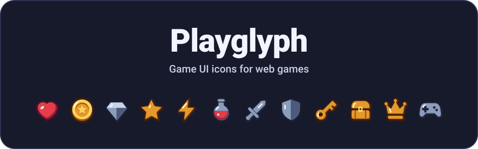
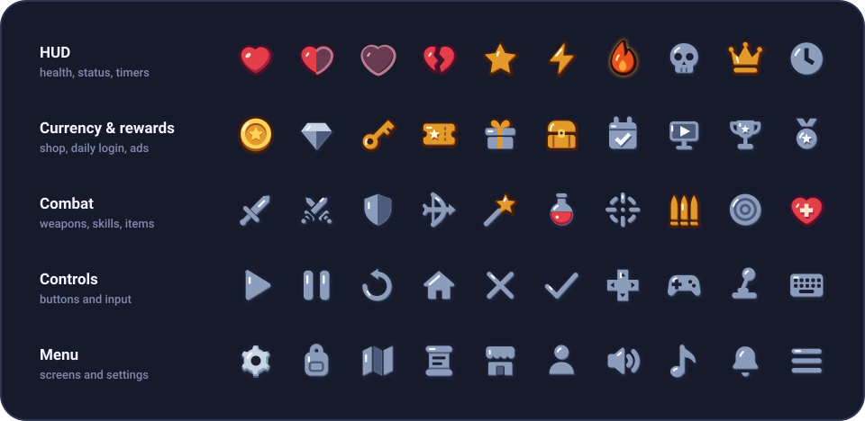
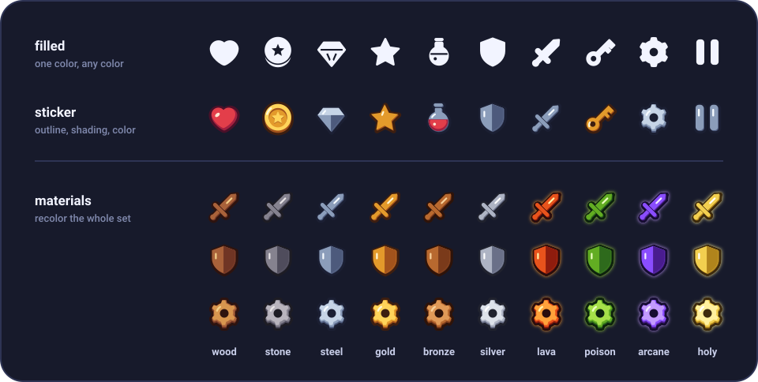

<p align="center">
  <a href="https://fe4902.github.io/playglyph/">
    
  </a>
</p>

<p align="center">
  <b>An SVG icon library made for web game UI.</b><br>
  134 icons for HUDs, currency, inventory, menus and controls, built for people making web games with AI.
</p>

<p align="center">
  <a href="https://fe4902.github.io/playglyph/">Site</a>
  ·
  <a href="https://fe4902.github.io/playglyph/preview/">Icon gallery</a>
  ·
  <a href="https://fe4902.github.io/playglyph/docs/">Docs</a>
  ·
  <a href="https://fe4902.github.io/playglyph/dist/llms.txt">llms.txt</a>
  ·
  <a href="LICENSE">ISC license</a>
</p>

<p align="center"><a href="README.md">한국어</a> · <b>English</b></p>

# Playglyph

App icon sets like Lucide and Font Awesome do not have what a game screen needs. Playglyph is built around game UI icons: health hearts (full, half, empty, broken), coins, gems, potions, reward chests, daily login, watch-ad, locked stages. The usual settings, sound, pause and menu icons are included too.

<p align="center">
  
</p>

## What makes it game-specific

<p align="center">
  
</p>

- **Two styles.** `filled` is a single-color glyph you can tint any color. `sticker` is a full-color icon with a thick outline and shading. All 134 icons are drawn in both.
- **Ten materials.** `wood`, `stone`, `steel`, `gold`, `bronze`, `silver`, `lava`, `poison`, `arcane`, `holy`. One material recolors the whole set to match your game. The last four glow.
- **814 aliases.** Lucide, Font Awesome and Material names (`trash-2`, `xmark`, `floppy-disk`, `play_arrow`) and game words (`mana`, `xp`, `inventory`, `bgm`) resolve to an icon. Case and separators are ignored. An unknown name renders a "?" icon and logs the closest names, so the page does not break.
- **`llms.txt` for AI coding.** Icon names, when to use each one, aliases and short usage examples in one file.
- **Canvas and game engines.** Turn an icon into an image or a canvas and draw it in Phaser, Pixi or plain canvas. Disabled and locked states are built in.
- **Pixel style (experimental).** 16 icons are also drawn as 16×16 `pixel` art.

No dependencies. React is an optional peer dependency.

## Install

Playglyph is not on npm yet (0.1.0). For now, add one script tag or download the ZIP.

```html
<script src="https://fe4902.github.io/playglyph/dist/playglyph.js"></script>
```

- ZIP: [playglyph-0.1.0.zip](https://fe4902.github.io/playglyph/playglyph-0.1.0.zip) (SVG sources, ES modules, the global script, React components, a sprite, llms.txt)
- After the npm release: `npm install playglyph`

## Usage

### HTML (no build step)

```html
<i data-pg="heart" data-style="sticker" data-size="32"></i>
<i data-pg="coin" data-style="sticker" data-size="32"></i>
<i data-pg="pause" data-color="#ffffff" data-size="32"></i>
<i data-pg="settings" data-style="sticker" data-material="wood"></i>
```

Elements with `data-pg` are replaced with SVG. Elements added later are drawn automatically.

Options: `data-style` (filled | sticker), `data-material`, `data-secondary`, `data-size`, `data-color`, `data-state` (disabled | locked), `data-border` (sticker rim color)

Or as plain images, without JavaScript:

```html


```

### ES modules

```js
import { Pause, toSvg } from 'playglyph';                  // filled
import { Coin, renderSticker } from 'playglyph/sticker';   // sticker
import { gold } from 'playglyph/materials';
import { icon } from 'playglyph/lookup';                   // look up by name (not tree-shaken)

el.innerHTML = toSvg(Pause, { size: 24, color: '#fff' });
el.innerHTML = renderSticker(Coin, { material: gold, size: 48 });
el.innerHTML = icon('mana', { style: 'sticker', size: 32 });
```

Until the npm release, import the files in the ZIP's `dist/` by path (`./playglyph-0.1.0/dist/index.js`, `dist/sticker.js`, `dist/materials.js`, `dist/lookup.js`).

### React

```jsx
import { Heart, Settings, PauseIcon } from 'playglyph/react';   // filled

<Heart size={24} color="tomato" />
```

### Canvas / game engines

Rasterize once at load time, then call `drawImage` every frame.

```js
import { Pause, toCanvas } from 'playglyph';
import { Coin, stickerToImage } from 'playglyph/sticker';

const coin = await stickerToImage(Coin, { size: 64 });
ctx.drawImage(coin, x, y, 32, 32);

const pause = await toCanvas(Pause, { size: 32, color: '#fff' });
this.textures.addCanvas('pause', pause);   // Phaser
```

With the script tag, use `playglyph.stickerToImage(playglyph.getIcon('coin', 'sticker'), { size: 64 })`.

### Pixel (experimental)

Pixel icons use material colors by default. `shading: 'mono'` draws them in one color (white unless you set `color`). Icons that lose their shape in one color, such as the heart and the coin, have a separate single-color drawing. The 16×16 art stays sharp at integer scales such as 32px and 48px.

```html
<i data-pg="heart" data-style="pixel" data-shading="mono" data-color="#54e0ba" data-size="32"></i>
```

```js
import { Heart, renderPixel } from 'playglyph/pixel';

el.innerHTML = renderPixel(Heart, { shading: 'mono', color: '#54e0ba', size: 32 });
```

`drawPixel()` and `pixelToCanvas()` take the same `shading` and `color` options.

## Using it with AI

Add these two lines to your prompt:

```text
Use Playglyph for the game UI icons (hearts, coins, settings, pause).
Icon names and usage: https://fe4902.github.io/playglyph/dist/llms.txt
```

Names are chosen so an AI can guess them. Concepts shared with Lucide use the Lucide name (`settings`, `volume-2`, `pause`), and on/off pairs use an `-off` suffix (`music` / `music-off`).

## More

- [Docs](https://fe4902.github.io/playglyph/docs/): install, options, full API
- [Icon gallery](https://fe4902.github.io/playglyph/preview/): all 134 icons by style and material
- [CONTRIBUTING.md](CONTRIBUTING.md) (Korean): repository layout, local preview, drawing rules, editing in Penpot
- [ROADMAP.md](ROADMAP.md) (Korean): which icons come next
- [CHANGELOG.md](CHANGELOG.md): changes (Korean)

## License

[ISC](LICENSE)
