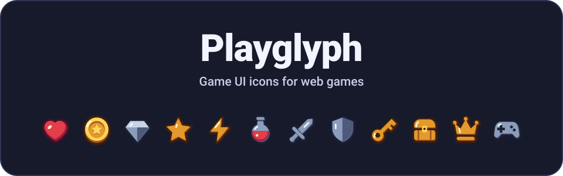
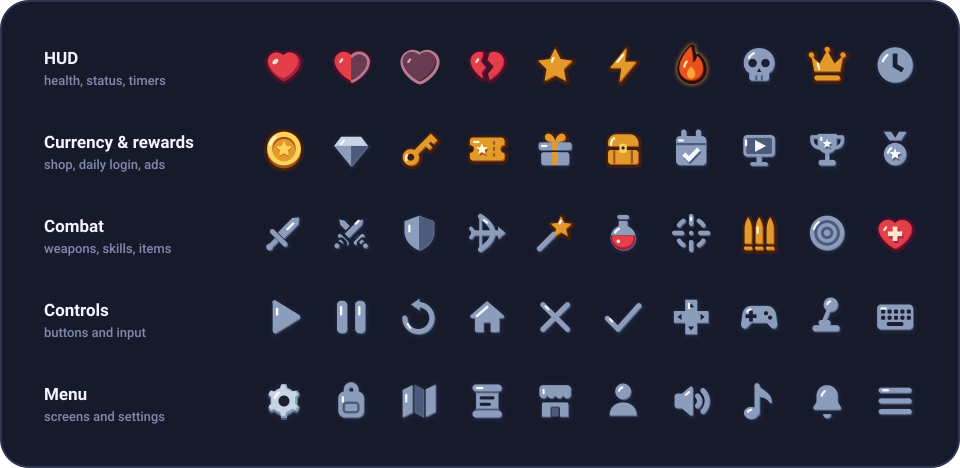
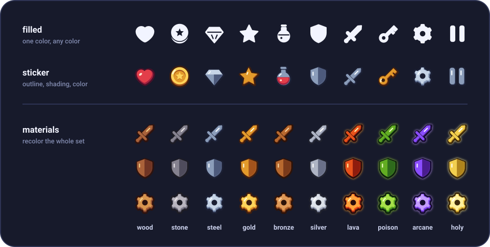

<p align="center">
  <a href="https://fe4902.github.io/playglyph/">
    
  </a>
</p>

<p align="center">
  <b>웹게임 UI 전용 SVG 아이콘 라이브러리.</b><br>
  HUD, 재화, 인벤토리, 메뉴, 조작 버튼에 쓰는 아이콘 134종을 AI와 함께 웹게임을 만드는 사람이 바로 쓰도록 만들었습니다.
</p>

<p align="center">
  <a href="https://fe4902.github.io/playglyph/">사이트</a>
  ·
  <a href="https://fe4902.github.io/playglyph/preview/">아이콘 갤러리</a>
  ·
  <a href="https://fe4902.github.io/playglyph/docs/">문서</a>
  ·
  <a href="https://fe4902.github.io/playglyph/dist/llms.txt">llms.txt</a>
  ·
  <a href="LICENSE">ISC 라이선스</a>
</p>

<p align="center"><b>한국어</b> · <a href="README.en.md">English</a></p>

# Playglyph

Lucide나 Font Awesome 같은 앱 아이콘 세트에는 게임 화면에 필요한 아이콘이 없습니다. Playglyph는 체력 하트(꽉 찬·반·빈·깨진 하트), 동전, 보석, 물약, 보상 상자, 출석, 광고 보기, 잠긴 스테이지 같은 게임 UI 아이콘이 중심이고, 설정·소리·일시정지·메뉴 같은 기본 아이콘도 함께 들어 있습니다.

<p align="center">
  
</p>

## 게임용으로 만든 점

<p align="center">
  
</p>

- **스타일 두 가지.** `filled`는 원하는 색으로 칠하는 단색 아이콘이고, `sticker`는 두꺼운 외곽선과 명암이 있는 컬러 아이콘입니다. 134종 모두 두 스타일로 그려져 있습니다.
- **재질 10종.** `wood`, `stone`, `steel`, `gold`, `bronze`, `silver`, `lava`, `poison`, `arcane`, `holy`. 재질 하나로 세트 전체를 게임 분위기에 맞춰 다시 칠합니다. 뒤의 네 개는 빛이 납니다.
- **별칭 814개.** Lucide·Font Awesome·Material 이름(`trash-2`, `xmark`, `floppy-disk`, `play_arrow`)과 게임 용어(`mana`, `xp`, `inventory`, `bgm`)가 그대로 통합니다. 대소문자와 구분자는 무시합니다. 없는 이름은 "?" 아이콘으로 그리고 콘솔에 비슷한 이름을 알려 주므로 화면이 깨지지 않습니다.
- **AI 코딩용 `llms.txt`.** 아이콘 이름, 쓰임새, 별칭과 짧은 사용 예가 한 파일에 들어 있습니다.
- **캔버스와 게임 엔진.** 아이콘을 이미지나 캔버스로 바꿔 Phaser, Pixi, 일반 canvas에 그립니다. 비활성·잠김 상태도 표현합니다.
- **도트 스타일 (실험적).** 16×16 `pixel` 아이콘이 16종 있습니다.

외부 의존성은 없습니다. React는 선택적 peer dependency입니다.

## 설치

아직 npm에 올라가지 않았습니다(0.1.0). 지금은 스크립트 한 줄을 넣거나 ZIP을 받아서 씁니다.

```html
<script src="https://fe4902.github.io/playglyph/dist/playglyph.js"></script>
```

- ZIP: [playglyph-0.1.0.zip](https://fe4902.github.io/playglyph/playglyph-0.1.0.zip) (SVG 원본, ES 모듈, 전역 스크립트, React 컴포넌트, 스프라이트, llms.txt)
- npm 공개 후: `npm install playglyph`

## 사용법

### HTML (빌드 없음)

```html
<i data-pg="heart" data-style="sticker" data-size="32"></i>
<i data-pg="coin" data-style="sticker" data-size="32"></i>
<i data-pg="pause" data-color="#ffffff" data-size="32"></i>
<i data-pg="settings" data-style="sticker" data-material="wood"></i>
```

`data-pg`가 붙은 요소가 SVG로 바뀝니다. 나중에 추가한 요소도 자동으로 그려집니다.

옵션: `data-style`(filled | sticker), `data-material`, `data-secondary`, `data-size`, `data-color`, `data-state`(disabled | locked), `data-border`(스티커 테두리 색)

자바스크립트 없이 이미지로도 씁니다.

```html


```

### ES 모듈

```js
import { Pause, toSvg } from 'playglyph';                  // filled
import { Coin, renderSticker } from 'playglyph/sticker';   // sticker
import { gold } from 'playglyph/materials';
import { icon } from 'playglyph/lookup';                   // 이름으로 찾기 (트리셰이킹 안 됨)

el.innerHTML = toSvg(Pause, { size: 24, color: '#fff' });
el.innerHTML = renderSticker(Coin, { material: gold, size: 48 });
el.innerHTML = icon('mana', { style: 'sticker', size: 32 });
```

npm 공개 전에는 ZIP의 `dist/` 파일을 경로로 불러옵니다(`./playglyph-0.1.0/dist/index.js`, `dist/sticker.js`, `dist/materials.js`, `dist/lookup.js`).

### React

```jsx
import { Heart, Settings, PauseIcon } from 'playglyph/react';   // filled

<Heart size={24} color="tomato" />
```

### Canvas / 게임 엔진

로딩 때 한 번 이미지로 만들고, 매 프레임에는 `drawImage`만 부릅니다.

```js
import { Pause, toCanvas } from 'playglyph';
import { Coin, stickerToImage } from 'playglyph/sticker';

const coin = await stickerToImage(Coin, { size: 64 });
ctx.drawImage(coin, x, y, 32, 32);

const pause = await toCanvas(Pause, { size: 32, color: '#fff' });
this.textures.addCanvas('pause', pause);   // Phaser
```

스크립트 태그로 불러왔다면 `playglyph.stickerToImage(playglyph.getIcon('coin', 'sticker'), { size: 64 })`처럼 씁니다.

### 도트 (실험적)

도트 아이콘은 기본으로 재질 색을 사용합니다. `shading: 'mono'`를 지정하면 한 색으로 그립니다(기본색은 흰색). 하트나 코인처럼 단색에서 형태가 뭉개지는 아이콘은 전용 도안을 사용합니다. 16×16 도안은 32px, 48px처럼 정수 배율에서 또렷하게 보입니다.

```html
<i data-pg="heart" data-style="pixel" data-shading="mono" data-color="#54e0ba" data-size="32"></i>
```

```js
import { Heart, renderPixel } from 'playglyph/pixel';

el.innerHTML = renderPixel(Heart, { shading: 'mono', color: '#54e0ba', size: 32 });
```

같은 `shading`과 `color` 옵션을 `drawPixel()`과 `pixelToCanvas()`에도 쓸 수 있습니다.

## AI와 함께 쓰기

프롬프트에 아래 두 줄을 넣으면 됩니다.

```text
Use Playglyph for the game UI icons (hearts, coins, settings, pause).
Icon names and usage: https://fe4902.github.io/playglyph/dist/llms.txt
```

이름 규칙은 AI가 맞히기 쉽게 정했습니다. Lucide와 겹치는 개념은 Lucide 이름을 따르고(`settings`, `volume-2`, `pause`), 켬/끔은 `-off` 접미사로 짝을 이룹니다(`music` / `music-off`).

## 더 보기

- [문서](https://fe4902.github.io/playglyph/docs/): 설치, 옵션, 전체 API
- [아이콘 갤러리](https://fe4902.github.io/playglyph/preview/): 134종을 스타일·재질별로 보기
- [CONTRIBUTING.md](CONTRIBUTING.md): 저장소 구조, 로컬 미리보기, 그리기 규칙, Penpot에서 고치기
- [ROADMAP.md](ROADMAP.md): 다음에 그릴 아이콘
- [CHANGELOG.md](CHANGELOG.md): 변경 기록

## 라이선스

[ISC](LICENSE)
